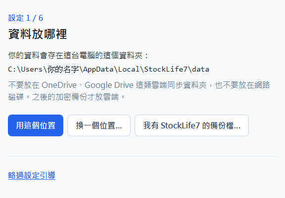
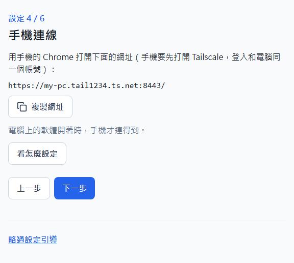
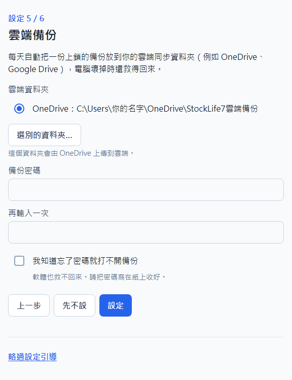
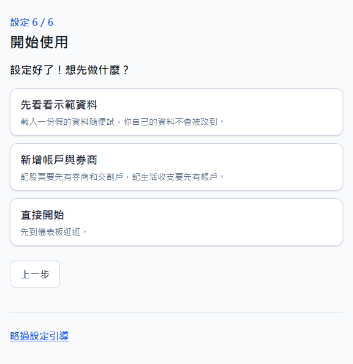

最新版下載：https://github.com/stanh10-0770/StockLife7-download/releases/latest

# 安裝與更新

給第一次用 StockLife7 的你：照這份從下載、安裝到開始用，大約 15 分鐘。StockLife7 是免費的台股記帳與生活記帳軟體，資料只存在你自己的電腦上。

## 需要什麼

- 一台 Windows 10 或 Windows 11 的電腦。
- 想用手機記帳的話：一支 Android 手機，加上免費的 Tailscale（讓手機連到你家裡的電腦，見下面「用手機」）。不用手機也可以，只在電腦上用。

## 下載

1. 用電腦的瀏覽器打開下載頁：https://github.com/stanh10-0770/StockLife7-download/releases/latest
2. 在頁面下方「Assets」那一區，點 `StockLife7-Setup-〔版本〕.exe`（例 `StockLife7-Setup-1.0.0.exe`）下載。
3. 瀏覽器可能會說這個檔「不常下載」之類，這是因為下載的人還不多，不是中毒：
   - **Edge**：在右上角的下載清單裡，把滑鼠移到這個檔上，按「…」→「保留」；再跳出提醒時按「顯示更多」→「仍要保留」。
   - **Chrome**：在下載清單裡按「保留」（只看到「刪除」時，按旁邊的箭頭或「⋮」找「保留」）。

## 安裝

1. 到「下載」資料夾，雙擊剛才下載的 `StockLife7-Setup-〔版本〕.exe`。
2. 第一次執行時，Windows 會跳出藍色的「Windows 已保護您的電腦」：按「其他資訊」，再按「仍要執行」。這是因為安裝檔沒有付費的數位簽章，不是中毒。
3. 照畫面按「下一步」：可以選要不要「建立桌面捷徑」（預設打勾），再按「安裝」。
4. 最後一頁勾著「立即開啟 StockLife7」，按「完成」就會打開軟體。

- 只裝給目前登入 Windows 的這個人，不用系統管理員，也不會跳出「是否允許變更」的視窗。
- 裝好後，桌面有 StockLife7 捷徑（有勾的話）；開始功能表有「StockLife7」和「解除安裝 StockLife7」。

## 打開軟體

雙擊桌面或開始功能表的 StockLife7：先出現小的啟動畫面，再出現主視窗。第一次打開會看到「設定引導」，一共六步，每一步都可以之後再改：

1. **資料放哪裡**：畫面寫你的資料會存在哪個資料夾，大部分人直接按〔用這個位置〕就好。不要放在 OneDrive 這類雲端同步資料夾裡。
   
2. **你的名字**：軟體裡怎麼稱呼你。
3. **PIN 鎖**：要不要設 4～8 位數字的 PIN，打開軟體時要先輸入。只有你自己用的電腦可以按〔先不設〕。
4. **手機連線**：寫一個給手機用的網址（要先裝好 Tailscale，見下面「用手機」）；還沒有手機的話直接按〔下一步〕。
   
5. **雲端備份**：每天自動把一份上鎖的備份放到 OneDrive 這類雲端同步資料夾，電腦壞掉時還救得回來。要設一個「備份密碼」，**忘了密碼備份就打不開**，請寫在紙上收好。也可以先按〔先不設〕，之後再到「設定 → 資料與備份」設。
   
6. **開始使用**：〔先看看示範資料〕可以先用假的資料隨便試，你自己的資料不會被改到；〔新增帳戶與券商〕直接開始記帳；〔直接開始〕先到儀表板逛逛。
   

- 做到一半關掉也沒關係，下次打開會從那一步繼續；不想照著做可以按最下面的〔略過設定引導〕。
- 之後想再看一次：「設定 → 一般」按〔重新看一次設定引導〕。
- 每一頁右上角的「？」都有這一頁的說明。

## 打開時說缺少 WebView2

StockLife7 的視窗要用到 Windows 的「Microsoft Edge WebView2」元件。Windows 11 都有、絕大多數 Windows 10 也有；少數電腦打開時會說「缺少 Microsoft Edge WebView2 元件」：

1. 用瀏覽器打開微軟官方的 WebView2 下載頁：https://developer.microsoft.com/microsoft-edge/webview2/
2. 找到「Evergreen Bootstrapper」，按下載，執行下載的檔，等它裝完。
3. 再打開一次 StockLife7。

## 用手機

在外面也能用手機打開家裡電腦上的 StockLife7，記一筆、看報表。要用免費的 Tailscale，只有你自己登入的設備連得到，別人連不到。

1. 到 https://tailscale.com/ 申請帳號（免費的個人方案；用 Google 帳號登入就可以）。
2. 在電腦上安裝 Tailscale（https://tailscale.com/download），用剛才的帳號登入。
3. 在 Android 手機的 Play 商店安裝 Tailscale，登入**同一個帳號**。
4. 回到電腦上的 StockLife7：設定引導第 4 步，或之後到「設定 → 一般」最下面的「手機連線」，有一個網址，按〔複製網址〕傳到手機，用手機的 Chrome 打開。

- 電腦上的 StockLife7 開著時手機才連得到。電腦關著時，打開過一次的手機可以先記收支、股票買賣，連上後再送回電腦。
- 手機打開後，可以用 Chrome 選單的「加到主畫面」，之後從主畫面的圖示打開。

## 出新版時

1. 軟體會提醒你：右上角的鈴鐺多一則「有新版 v版本」，「設定 → 關於」的「新版」那一行也會寫。
2. 在「設定 → 關於」按〔打開下載頁〕，或用瀏覽器打開上面的下載頁，下載新的安裝檔 `StockLife7-Setup-〔版本〕.exe`（瀏覽器的提醒照上面「下載」的做法）。
3. 把 StockLife7 完全關掉，再執行新的安裝檔，照畫面裝完。資料會保留並自動升級。

- 軟體只會提醒、打開下載頁，不會自己下載或安裝；檢查新版時不會送出你的任何資料。

### 升級到新版

1. 拿到新版的安裝檔，直接雙擊執行，照畫面裝完。
2. 軟體正開著時，安裝程式會說「StockLife7 正在執行，請先關閉後再繼續。」：先把軟體完全關掉（右下角小圖示按右鍵選「結束」），再按「重試」。
3. 裝好後打開軟體：資料會先自動備份、再自動升級；第一次打開會跳出「這版改了什麼」。

- 設定、字體大小、備份清單都會保留；升級不會再出現設定引導。
- 原本沒建桌面捷徑的，升級後也不會自己冒出來。

### 裝回舊版

- 已經裝了比較新的版本，又執行舊版的安裝檔時，會先問「已經安裝較新的版本……確定要改裝舊的……嗎？舊版可能打不開新版的資料。」
- 按「否」就不會改裝。按「是」會裝回舊版；如果資料已經被新版升級過，舊版打開時會說「這份資料是由較新版本的 StockLife7 建立的……請安裝最新版本後再開啟。」，這時請再裝回新版。

## 資料與解除安裝

### 資料放在哪裡

- 你的資料只存在這台電腦上，預設的資料夾是 `C:\Users\〔你的 Windows 帳號〕\AppData\Local\StockLife7\data`（設定引導第 1 步選的位置；「設定 → 關於」也看得到）。
- 軟體每天會自動備份一份在這台電腦上；**記得設雲端備份**（「設定 → 資料與備份」的「雲端備份」），電腦壞掉、換電腦時才救得回來。
- 軟體開著的時候，不要去搬動或複製資料資料夾裡的檔案。

### 解除安裝

1. 開始功能表 →「解除安裝 StockLife7」（或 Windows 設定 → 應用程式 → StockLife7 → 解除安裝）。
2. 軟體正開著時一樣會請你先關閉。
3. 結束時會顯示「StockLife7 已移除。你的資料保留在〔資料資料夾的位置〕，重新安裝後會自動接回來；如果確定不要了，可以自己刪除這個資料夾。」

- 解除安裝**不會刪除你的資料**和備份，只移除程式本身、捷徑和「已安裝的應用程式」那一列。
- 確定以後都不用了，再自己刪除訊息裡寫的那個資料夾。

## 有問題時

- 直接問給你這個軟體的人。下載頁沒有留言功能。
- 軟體出錯時，可以到「設定 → 關於」按〔匯出錯誤資訊〕，把產生的檔傳給他；檔案裡不含金額、股票代號、券商名稱、密碼。
